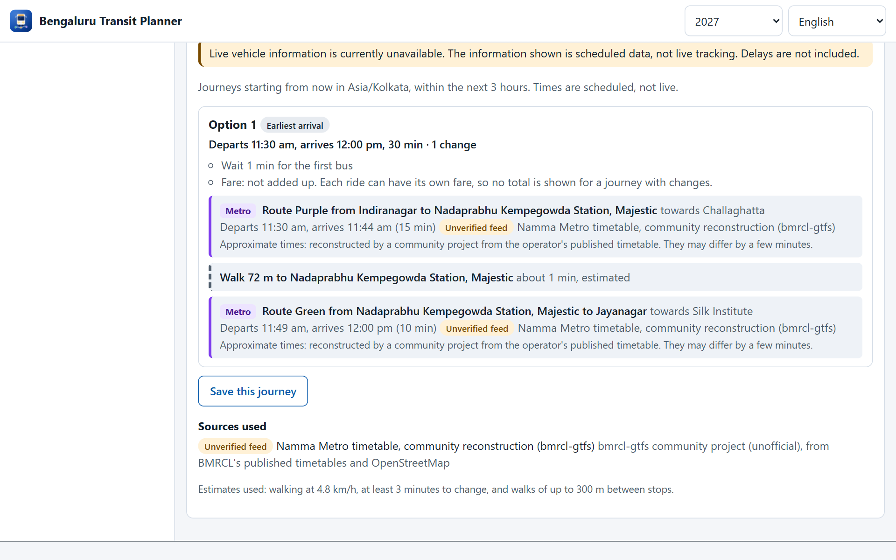
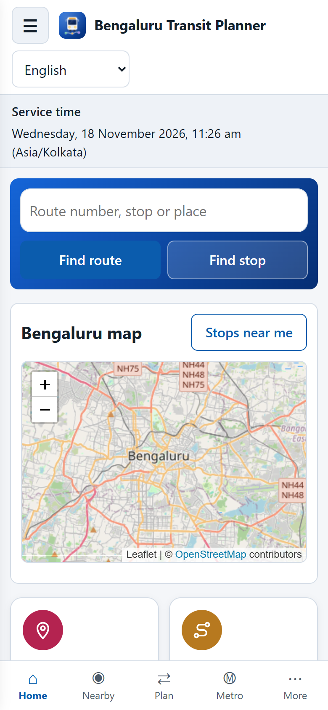
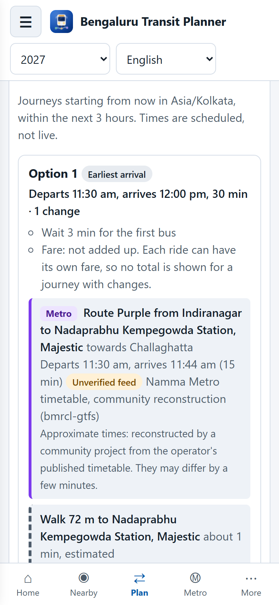
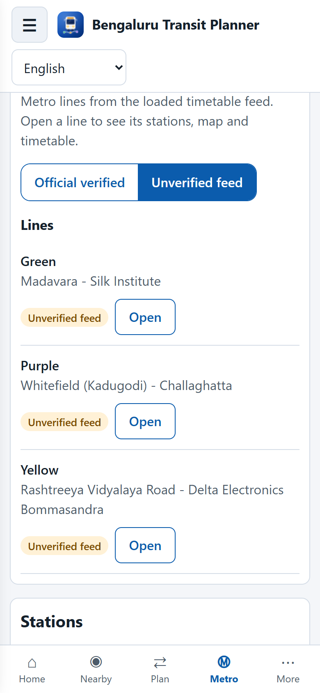
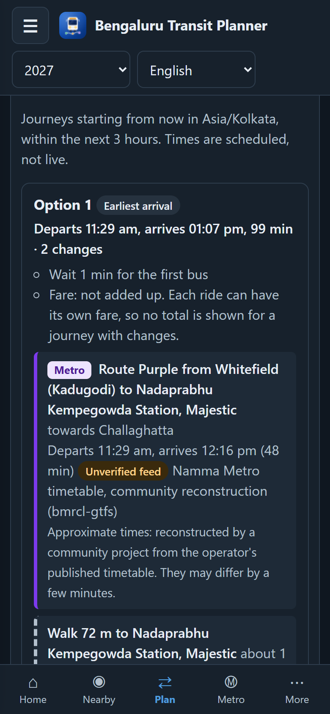
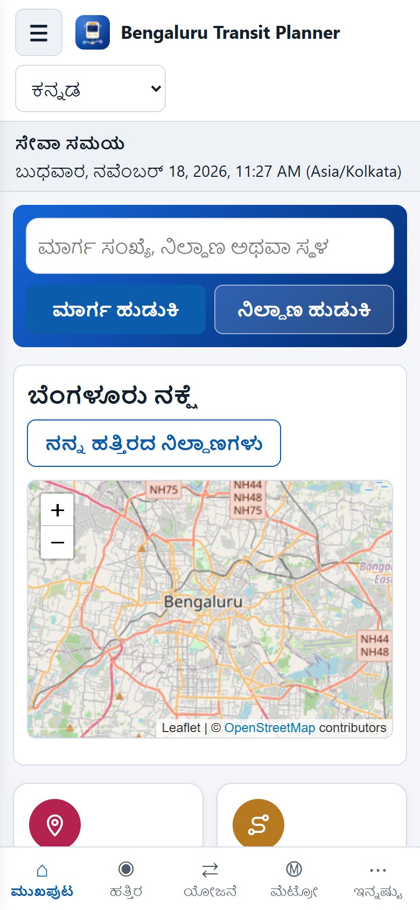
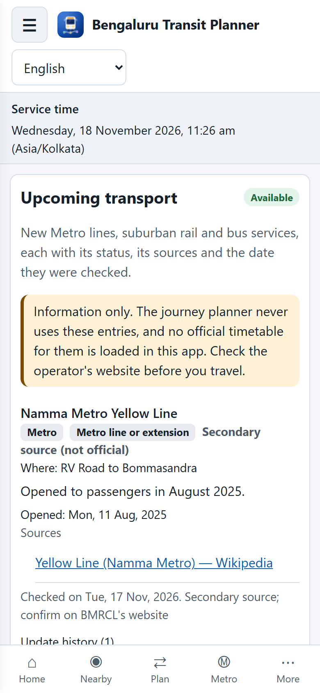
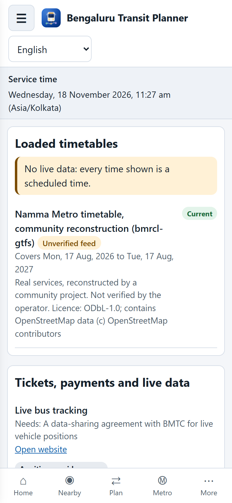
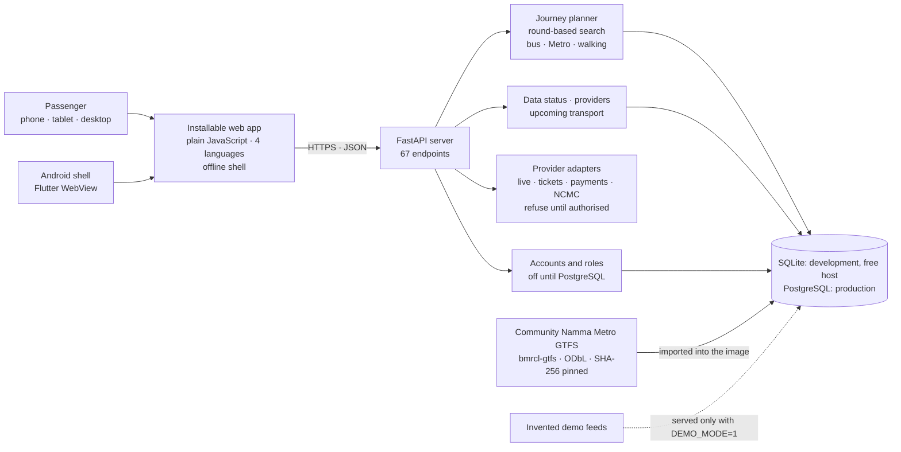

<div align="center">


[](https://github.com/upendra8690/BMTC-Future-Transit-Planner-3.0/actions/workflows/ci.yml?query=branch%3Av4)


<a href="https://bengaluru-transit-planner-v4.onrender.com"></a>
&nbsp;
<a href="https://bmtc-future-transit-planner-3-0.onrender.com"></a>

**A free, multilingual journey planner for Bengaluru: Namma Metro today, buses when lawful data exists.**<br>
English · ಕನ್ನಡ · తెలుగు · हिन्दी · phone, tablet and desktop · works offline for pages already opened

</div>

> [!IMPORTANT]
> **Independent and unofficial.** This project is not affiliated with, endorsed by or approved by BMTC, BMRCL
> (Namma Metro), DULT or the Government of Karnataka.
> - **Metro data:** comes from an *unofficial community reconstruction* of BMRCL's published timetables. It is
>   **not verified by BMRCL**, and times between the published ones are **approximate**.
> - **No bus data:** there is **no BMTC bus data** yet.
> - **Not available:** live tracking, tickets, passes and payments.
>
> Always check the operator before you travel. In an emergency, call **112**.

<details>
<summary><b>Contents</b></summary>

- [Try it](#-try-it)
- [Version 3.0 and 4.0](#-version-30-and-40)
- [Screenshots](#-screenshots)
- [What works today](#-what-works-today)
- [Real data, honest labels](#%EF%B8%8F-real-data-honest-labels)
- [Architecture](#%EF%B8%8F-architecture)
- [Run it yourself](#-run-it-yourself)
- [Configuration](#%EF%B8%8F-configuration)
- [Quality and test results](#-quality-and-test-results)
- [Privacy](#-privacy)
- [Security](#%EF%B8%8F-security)
- [Accessibility and languages](#-accessibility-and-languages)
- [Known limitations](#%EF%B8%8F-known-limitations)
- [Roadmap](#%EF%B8%8F-roadmap)
- [Documentation](#-documentation)
- [Data sources and attribution](#-data-sources-and-attribution)
- [Licence](#-licence)

</details>

## 🚀 Try it

| | Address | What you see |
|---|---|---|
| **4.0 public preview** | **https://bengaluru-transit-planner-v4.onrender.com** | Real Namma Metro journeys from the community feed; no invented data |
| 3.0 stable | https://bmtc-future-transit-planner-3-0.onrender.com | The earlier bus planner and 2027–2030 scenarios, on clearly labelled demo data |

**Try a real Metro journey:** open **Plan**, choose **Unverified feed**, and enter **Indiranagar** → **Jayanagar**
with **Metro only**. You get a Purple Line ride, a 72 m walk at Majestic, then a Green Line ride, each labelled
"Approximate times".

> [!NOTE]
> Both services run on Render's free plan. They sleep when idle, so the first visit can take up to a minute (3.0 once
> took about 12 minutes to wake). To install the app, open the 4.0 address in Chrome and choose **Install app** or
> **Add to Home screen**.

## 🔀 Version 3.0 and 4.0

| | **3.0 stable** (`main`) | **4.0 public preview** (`v4`) |
|---|---|---|
| Address | bmtc-future-transit-planner-3-0.onrender.com | **bengaluru-transit-planner-v4.onrender.com** |
| Focus | Bus timetables and 2027–2030 planning scenarios | A passenger app: Metro journeys, stations, upcoming transport, official links |
| Data shown | An invented demo bus feed, labelled as such | **Real Namma Metro** (unofficial community feed, labelled); no invented data |
| Metro | — | Purple, Green and Yellow lines: 83 stations, changes at Majestic and RV Road |
| Interface | Planner dashboard | Mobile-first installable web app (18 screens), dark mode, large text, low-data mode |
| Upcoming transport | — | 7 projects with status, source and check date; editable by administrators |
| Accounts | — | Built and tested, **switched off** until a permanent database is configured |
| Android | APK release `app-latest` | Shell fixed (calls, official links, back button); compiles in CI; **not published** |
| Status | Stable; unchanged | Preview; under active development |

## 📸 Screenshots

All screenshots were taken from the live 4.0 preview on 18 November 2026, in real mode.

<p align="center">
  
</p>

<table>
  <tr>
    <td align="center" width="25%"><br><sub><b>Home</b></sub></td>
    <td align="center" width="25%"><br><sub><b>Real Metro journey</b></sub></td>
    <td align="center" width="25%"><br><sub><b>Metro lines</b></sub></td>
    <td align="center" width="25%"><br><sub><b>Dark mode, 2 changes</b></sub></td>
  </tr>
  <tr>
    <td align="center"><br><sub><b>ಕನ್ನಡ</b></sub></td>
    <td align="center"><br><sub><b>Upcoming transport</b></sub></td>
    <td align="center"><br><sub><b>Data sources</b></sub></td>
    <td align="center"><br><sub><b>App icon</b></sub></td>
  </tr>
</table>

## ✅ What works today

| | Feature | Status |
|---|---|---|
| 🚇 | **Metro journey planner**: Metro only, up to 2 changes, walking transfers | **Works** on the community feed; times approximate |
| 🟣🟢🟡 | **Purple, Green and Yellow lines**: 83 stations; line and station pages | **Works** (unverified data) |
| 🔎 | Station and route search; exact names win ("Jayanagar" never becomes "Vijayanagar") | **Works** |
| 🗺️ | Bengaluru map (OpenStreetMap), stops near me (location only when you tap) | **Works** |
| 🏗️ | **Upcoming transport**: status, source, check date and public change history | **Works**; administrators update it without code changes |
| 💾 | Saved journeys and stops on your device; "Delete my data" | **Works** |
| 🌐 | English, ಕನ್ನಡ, తెలుగు, हिन्दी | **Works**; native-speaker review pending |
| 📴 | Installable web app; screens and saved items open offline | **Works** |
| 🆘 | SOS **112**, ambulance 108, fire 101, child helpline 1098, railway enquiry 139, official websites | **Works** |
| 🛠️ | Administration: GTFS import and validation, verification, upcoming entries, backups (SQLite), audit log | **Works** (admin key) |
| 🚌 | BMTC bus routes, stops and timetables | ⛔ **Unavailable**: no authorised data source |
| 📡 | Live tracking and arrival predictions | ⛔ **Unavailable**: "Live vehicle information is currently unavailable. The information shown is scheduled data, not live tracking." |
| 🎟️ | Tickets, passes, Metro QR, payments, wallet, NCMC | ⛔ **Unavailable**: each needs an operator or provider agreement; links go to official channels |
| 💰 | Metro fares | ⛔ **Not shown**: the community feed's fares are estimates |
| 👤 | Passenger accounts, saved journeys across devices, staff roles | ⏸️ **Built, switched off**: needs a permanent PostgreSQL database |
| 🔔 | Notifications | ⏸️ Preferences stored; nothing is sent (no delivery service) |
| 🏥 | Hospitals, toilets, water, parking, EV charging, station facilities | ⛔ **Not yet**: no licensed dataset chosen |

## 🏷️ Real data, honest labels

- **Real mode is the default.** The public service never serves invented data, even if a demo feed is loaded. A
  separate **demonstration server** (`DEMO_MODE=1`) is for development and presentations; it shows a banner on every
  screen.
- **Three labels.**
  - *Officially verified*: only an `OFFICIAL` source, checked by an administrator. There is none today, and the app
    says so.
  - *Unverified feed*: real but not confirmed by the operator. This is the community Metro feed.
  - *Estimated scenario*: the 2027–2030 planning screens.
- **No invented numbers.** Community fares are never shown as prices, times between published ones are marked
  "Approximate", and an expected opening date is shown only if an operator announced it.
- **Every ride names its source.**

## 🏛️ Architecture



| Layer | Technology |
|---|---|
| Server | Python 3.12 and 3.13, FastAPI, SQLAlchemy 2, Alembic migrations, psycopg 3 |
| Database | SQLite for development; PostgreSQL for production (proven in CI on PostgreSQL 16) |
| App | Progressive web app in plain JavaScript (no build step), service worker, Leaflet 1.9.4 with OpenStreetMap tiles |
| Android | Flutter WebView shell (`android/flutter_app`), built only by GitHub Actions |
| Packaging | Docker (Python 3.13 slim, unprivileged user), listens on `$PORT`; Render Blueprint in `render.yaml` |
| Quality | pytest, Playwright with Microsoft Edge, axe-core, ruff, bandit, pip-audit, GitHub Actions |

<details>
<summary><b>Project layout</b></summary>

```text
backend/app/            FastAPI app: api.py, models.py, security.py, demo.py, config.py
backend/app/services/   planner, schedule, registry, announcements, accounts, integrations, assistant
dashboard/              the web app: index.html, app.js, i18n.js (4 languages), styles.css, sw.js
migrations/             Alembic migrations 0001 to 0004
reference_data/         the pinned community Namma Metro feed, with its licence and attribution
scripts/                migrate, import, load_community_metro, verify_deployment, check_persistence, ...
tests/                  pytest suites; tests/browser and tests/audit hold the browser, accessibility and security checks
android/flutter_app/    Android WebView shell
government_submission_2026/   technical-review package (drafts; nothing has been sent)
```
</details>

## 💻 Run it yourself

**Linux and macOS** (Python 3.12 or newer):

```bash
git clone -b v4 https://github.com/upendra8690/BMTC-Future-Transit-Planner-3.0.git
cd BMTC-Future-Transit-Planner-3.0
python -m venv .venv && source .venv/bin/activate
python -m pip install -r requirements-dev.txt
python scripts/migrate_database.py
python scripts/load_community_metro.py        # the real Namma Metro feed (checked by SHA-256)
python -m uvicorn app.main:create_app --factory --app-dir backend --port 8000
```

Open http://127.0.0.1:8000. The interactive API reference is at http://127.0.0.1:8000/api/docs.

**Windows PowerShell:** the same steps, but activate the environment with `.venv\Scripts\Activate.ps1`.

**Docker:**

```bash
docker build -t bengaluru-transit-planner .
docker run -p 8000:8000 bengaluru-transit-planner                  # real mode, as the public service runs
docker run -p 8000:8000 -e DEMO_MODE=1 bengaluru-transit-planner   # demonstration server, with a banner
```

**Demonstration mode without Docker:** run `python scripts/seed_demo_feed.py`, then start the server with
`DEMO_MODE=1`. Try **Demo Central** → **Demo Junction**.

**Deploying to Render:** follow [`docs/launch/DEPLOYMENT_GUIDE.md`](docs/launch/DEPLOYMENT_GUIDE.md). Then check any
deployment with:

```bash
python scripts/verify_deployment.py https://bengaluru-transit-planner-v4.onrender.com \
  --v3 https://bmtc-future-transit-planner-3-0.onrender.com
```

## ⚙️ Configuration

| Variable | Default | Purpose |
|---|---|---|
| `DATABASE_URL` | SQLite in `data/` | `postgresql://…` for production. Set it only in the hosting dashboard, never in Git or chat |
| `ADMIN_API_KEY` | not set (admin off) | Administration key; use 32 or more random characters |
| `DEMO_MODE` | `0` | `1` makes a demonstration server; **never** set it on the public service |
| `LOAD_COMMUNITY_METRO` | `1` (container) | Loads the community Metro feed at start if missing |
| `ACCOUNTS_ENABLED` | `0` | `1` turns on accounts, which start only with PostgreSQL |
| `RATE_LIMIT_PER_MINUTE` | `120` | Requests per minute for each visitor |
| `PORT` | `8000` (container) | The port the container listens on |
| `SERVICE_TIMEZONE`, `CORS_ORIGINS`, `LOG_LEVEL`, `MAX_UPLOAD_MB` | see `backend/app/config.py` | Advanced settings |

## 🧪 Quality and test results

Results from the latest verified commit, **`aafdc4f`** (18 November 2026). Live status: the CI badge above.

| Check | Result | Run on |
|---|---|---|
| GitHub Actions CI: tests (Python 3.12 and 3.13), container in demo and real mode, PostgreSQL | ✅ **4/4 jobs passed** (push and pull request) | `aafdc4f` |
| Unit, API, integration, migration and static front-end tests (`pytest`) | ✅ **501 passed**, 5 skipped (PDF tests needing a font), 0 failed | `aafdc4f` |
| Lint (ruff), static security (bandit), dependency audit (pip-audit) | ✅ clean | `aafdc4f` |
| Data survives a restart on PostgreSQL 16 (saved route, admin change, account and its journey) | ✅ passed in CI | `aafdc4f` |
| Public deployment checks (`scripts/verify_deployment.py`, real mode) | ✅ **12/12** | live service, `aafdc4f` |
| Real-mode browser check on the public site | ✅ **14/14** | live service, `aafdc4f` |
| Launch screens: 4 languages, phone and desktop | ✅ **268/268** | `aafdc4f` |
| Accessibility (axe-core, WCAG 2.1 A/AA): 15 screens × light and dark | ✅ **0 violations** | `aafdc4f` |
| End-to-end crawl: every control on 20 screens, forms, the passenger journey | ✅ **1,028/1,028**; 869 controls, 0 decorative or broken | `fb8d2a2` (no screens added since) |
| Browser regression, 3.0 and 4.0 screens | ✅ **121/121** | `fb8d2a2` |
| Security probes (auth, isolation, injection, XSS, limits) | ✅ **34/34** | `fb8d2a2` |

Not yet tested by people: a real Android phone, a screen reader, and native-speaker review of the translations. No
independent penetration test has been done.

## 🔒 Privacy

- **No accounts in use.** A random device key keeps your saved items apart; the server stores only its SHA-256 hash.
- **Not stored:** names, phone numbers, emails, locations, searches or payment details.
- **No tracking:** no analytics, and no access log of searches.
- **Location:** asked for only when you tap **Stops near me**, and never stored.
- **Erasure:** **Delete my data** removes everything kept about your device.

Draft policy: [`docs/government/PRIVACY_POLICY.md`](docs/government/PRIVACY_POLICY.md).

## 🛡️ Security

- **Browser hardening:** a strict content security policy (`script-src 'self'`), HSTS and security headers on every
  response, and a per-visitor rate limit.
- **Administration:** a secret key compared in constant time. Prepared roles (passenger, editor, admin) name each
  signed-in staff member in the audit log.
- **Accounts, when enabled:** scrypt password hashes, hashed bearer sessions (never cookies), lockout after repeated
  failures and one-time recovery codes.
- **Provider actions:** every one goes through an adapter that refuses until an agreement exists, so no fake ticket,
  QR code or payment can be produced.
- **Releases:** a push to `v4` can never publish an Android release (`tests/test_release_guard.py`).

Self-assessment: [`V4_SECURITY_REPORT.md`](V4_SECURITY_REPORT.md). Open items: one shared admin key until accounts
run, inline styles in the content security policy, and no independent penetration test.

## ♿ Accessibility and languages

- **Automated checks:** WCAG 2.1 AA scans show 0 violations on every main screen in light and dark themes, and every
  screen fits a 390-pixel phone without sideways scrolling.
- **Display settings:** large text, dark mode and low-data mode.
- **Languages:** the whole interface is in English, Kannada, Telugu and Hindi, and a test fails if any text is missing
  in any language. Station names appear as the data source publishes them.

## ⚠️ Known limitations

- **Official data:** none. The Metro data is unofficial and approximate, and the **elevated Pink Line** (opened
  14 Nov 2026 per press reports) is missing from it.
- **BMTC buses:** no data; no authorised source exists yet.
- **Live and payments:** no live information, tickets or payments.
- **Hosting:** the free service sleeps and erases its disk on restart, so saved routes and admin edits on the server
  are lost until PostgreSQL is configured.
- **Wording:** a Metro journey says "Wait *n* min for the first **bus**" even when the first ride is a train. This
  will be fixed in the next code update.
- **Assistant:** the travel assistant follows fixed rules (not AI) and understands English questions only.

Full list: [`docs/launch/DATA_COVERAGE_REPORT.md`](docs/launch/DATA_COVERAGE_REPORT.md) and
[`FINAL_IMPLEMENTATION_REPORT.md`](FINAL_IMPLEMENTATION_REPORT.md).

## 🗺️ Roadmap

| When | Item |
|---|---|
| **Next** (no permission needed) | Fix the "first bus" wording; administrator service notices with an official source and an expiry date; remove inline styles; phone and screen-reader tests |
| **After PostgreSQL is configured** | Account screens (sign in, saved journeys across devices, notification choices), per-person admin accounts |
| **With official data** (requests drafted for DULT, BMTC, BMRCL) | Verified bus and Metro timetables, the Pink Line, official fares, then live data under an agreement |
| **Only with written agreements** | Tickets, passes, Metro QR, payments, NCMC |

## 📚 Documentation

| Document | What it covers |
|---|---|
| [`FINAL_IMPLEMENTATION_REPORT.md`](FINAL_IMPLEMENTATION_REPORT.md) | What is done, what is next, what needs the owner |
| [`FINAL_SUBMISSION_READINESS.md`](FINAL_SUBMISSION_READINESS.md) | Commit, deployment, test results, suitability |
| [`docs/launch/DATA_COVERAGE_REPORT.md`](docs/launch/DATA_COVERAGE_REPORT.md) | What is real, unverified, missing or restricted |
| [`docs/launch/POSTGRESQL_PRODUCTION.md`](docs/launch/POSTGRESQL_PRODUCTION.md) | Production database, costs and backups |
| [`docs/launch/ACCOUNTS_AND_ROLES.md`](docs/launch/ACCOUNTS_AND_ROLES.md) | Accounts, sessions, roles, notifications |
| [`docs/launch/DEPLOYMENT_GUIDE.md`](docs/launch/DEPLOYMENT_GUIDE.md) | Render setup, environment, checking a deployment |
| [`government_submission_2026/`](government_submission_2026/) | Technical-review package and draft letters (not sent) |
| [`CHANGELOG.md`](CHANGELOG.md) | Every change on `v4` |

## 📊 Data sources and attribution

| Source | Used for | Licence |
|---|---|---|
| [bmrcl-gtfs](https://github.com/Vonter/bmrcl-gtfs) community project, commit `f402c4c` (17 Aug 2026) | Namma Metro stations, lines and timetables | ODbL 1.0 |
| [OpenStreetMap](https://www.openstreetmap.org/copyright) contributors | Map tiles; station positions within the feed above | ODbL |
| BMRCL published timetables ([bmrc.co.in](https://www.bmrc.co.in/metro-timings/)) | The original timetable information the feed was built from | Operator's content; not republished here |
| Press and secondary sources, each linked in the app | Upcoming-transport statuses | Cited, not copied |

> Contains information from bmrcl-gtfs, which is made available under the Open Database License (ODbL). Contains
> OpenStreetMap data © OpenStreetMap contributors. Timetable information originally published by Bengaluru Metro
> Rail Corporation Limited.

Details and the pinned SHA-256:
[`reference_data/namma_metro_community/README.md`](reference_data/namma_metro_community/README.md).

The community BMTC feed (bmtc-gtfs) is **not used**, because it is built from the Namma BMTC app's own data
interface.

## 📄 Licence

**No open-source licence has been chosen for this project yet,** so default copyright applies. The code is publicly
available to read, but not licensed for reuse. Third-party components keep their own licences:
- Leaflet 1.9.4 (BSD 2-Clause, in `dashboard/vendor/leaflet/`);
- the Metro feed and OpenStreetMap data (ODbL);
- axe-core 4.14.0, used only by the tests (MPL 2.0).

---

<div align="center">

Made in Bengaluru by [Mopuru Upendra Reddy](https://github.com/upendra8690) · an independent project, not an official
BMTC or BMRCL service · in an emergency, call **112**

</div>
