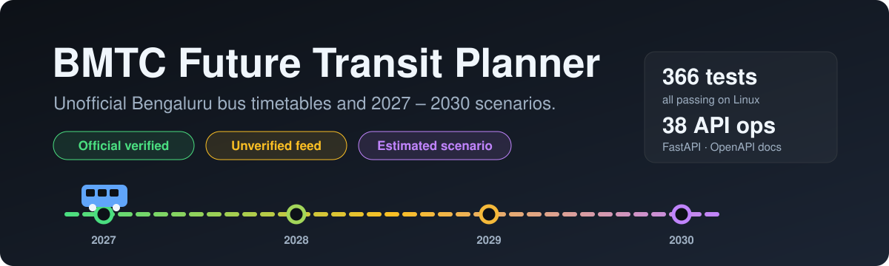
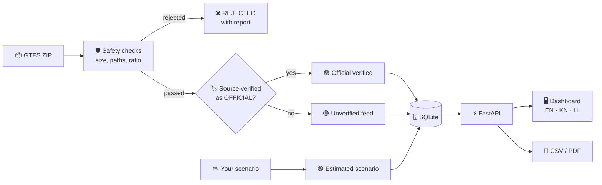

<div align="center">



<br>


**[What it does](#-what-it-does-in-30-seconds)  ·  [Screenshots](#-screenshots)  ·  [Try it](#-try-it-in-60-seconds)  ·  [Features](#-features)  ·  [How it works](#-how-it-works)  ·  [Quality](#-quality-and-testing)  ·  [Glossary](#-glossary)**

</div>

<br>

## 👋 What it does, in 30 seconds

Bengaluru is growing fast, and people want to know: *what will the buses look like in 2027, 2028, 2029, 2030?*

The problem is that **nobody has official timetables for those years yet**, and a planning tool that blurs guesses with
facts is worse than no tool at all.

**BMTC Future Transit Planner keeps three kinds of information strictly apart**, and labels every screen so you always
know what you are looking at:

| | Classification | What it means |
|:---:|---|---|
| 🟢 | **Official verified** | Timetables from an `OFFICIAL` source that an administrator has checked and verified. |
| 🟡 | **Unverified feed** | Any other GTFS feed: community, third-party or demo. Shown separately, always labelled. |
| 🟣 | **Estimated scenario** | Your own "what if" bus route for a future year, with journey time worked out from labelled assumptions. **Never** an official announcement. |

When there is no verified timetable for a year, the planner says so plainly instead of inventing one:

> 🗨️ *"No officially verified timetable is available for this future year."*

<div align="center">

### 📊 At a glance

| **159** | **36** | **5 / 5** | **35** | **2027 – 2030** |
|:---:|:---:|:---:|:---:|:---:|
| automated tests passing | browser checks passing | deliberately broken safety rules caught | API operations | planning years |

<sub>Test runs were on Linux with Python 3.13. See <a href="#-quality-and-testing">Quality and testing</a> for exactly what was and wasn't checked.</sub>

</div>

## 📸 Screenshots

<table>
<tr>
<td width="50%"></td>
<td width="50%"></td>
</tr>
<tr>
<td align="center"><b>Routes and timetables</b><br><sub>Every page opens with the status of the chosen year for each classification.</sub></td>
<td align="center"><b>Data sources</b><br><sub>Every source shows its publisher, licence and whether anyone verified it.</sub></td>
</tr>
</table>

<sub>Real screenshots of the running app, using the invented demo feed. No official BMTC data is shown.</sub>

## 🪤 Why this is harder than it looks

| Situation | The trap | ✅ What the planner does |
|---|---|---|
| A community feed has a route called `500D` | It looks official, but nobody verified it | Shows it only under **Unverified feed**, never mixed with official data |
| A user plans a new route for 2029 | It could be mistaken for a real BMTC plan | Stamps it **ESTIMATED SCENARIO** everywhere, including CSV and PDF exports |
| A scenario reuses an official route number | People could confuse the two | The API returns a **warning** when the code matches an official route |
| A feed covers only half of 2028 | "Has data for 2028" would overstate it | Reports coverage as **all**, **part** or **none** of each year |
| Someone uploads a malicious ZIP | Zip bombs, path tricks, huge files | Checks size, member count, compression ratio and paths, then **rejects** the feed with a report |
| An admin verifies the wrong source | Bad data becomes "official" | Only `OFFICIAL` sources can be verified, every change is **audit logged**, and verification can be **revoked** |

## 🚀 Try it in 60 seconds

You need [Python 3.11 or newer](https://www.python.org/downloads/).

```bash
# 1. Download the project
git clone https://github.com/upendra8690/BMTC-Future-Transit-Planner.git
cd BMTC-Future-Transit-Planner

# 2. Create a virtual environment and install
python -m venv .venv
. .venv/bin/activate                 # Windows: .venv\Scripts\activate
pip install -r requirements-dev.txt

# 3. Configure (then set ADMIN_API_KEY to a long random value)
cp .env.example .env                 # Windows: copy .env.example .env

# 4. Create the database
python scripts/migrate_database.py

# 5. (Optional) load the invented demo feed so there is something to explore
python scripts/make_synthetic_gtfs.py --out data/demo_feed.zip
python scripts/import_gtfs.py --file data/demo_feed.zip --new-source "Demo publisher" --kind SYNTHETIC_DEMO

# 6. Start the planner
python -m uvicorn app.main:create_app --factory --app-dir backend --host 127.0.0.1 --port 8000
```

Then open **http://127.0.0.1:8000/** for the dashboard, or **http://127.0.0.1:8000/api/docs** for the interactive API docs.

> [!TIP]
> **On Windows?** Run `scripts\setup_windows.bat` once, set `ADMIN_API_KEY` in `.env`, then double-click
> `scripts\run_windows.bat`. The full guide is in [docs/INSTALL_WINDOWS.md](docs/INSTALL_WINDOWS.md).

<details>
<summary><b>🔌 Call the API directly</b></summary>

<br>

```bash
# Health check
curl http://127.0.0.1:8000/api/health

# Search the unverified demo routes
curl "http://127.0.0.1:8000/api/routes?classification=UNVERIFIED_FEED&q=DEMO"

# Coverage of every planning year
curl http://127.0.0.1:8000/api/years/compare
```

All 35 operations are listed in [docs/API.md](docs/API.md).

</details>

## ✨ Features

<table>
<tr>
<td width="50%" valign="top">

### 🧭 For riders and planners
- 🔎 **Route and stop search**, by number, name or GTFS ID
- 🕐 **Timetables by date**, with CSV download
- 📍 **Nearby stops** within a radius you choose
- 🚏 **Direct journeys** between two stops
- 🗺️ **Map view** with Leaflet and OpenStreetMap
- ⭐ **Saved routes** and preferences per device
- 🌐 **English, ಕನ್ನಡ and हिन्दी** interface
- 📱 **Installable web app** with an offline shell

</td>
<td width="50%" valign="top">

### 🔮 For future scenarios
- ➕ **Create scenarios** for 2027 to 2030: route, stops, first and last bus, frequency, days
- 📐 **Transparent estimates** of distance and journey time
- ⚖️ **Side-by-side comparison** of two scenarios
- 📄 **PDF and CSV export**, labelled as estimates
- 🔐 **Private to each device**, identified by a hashed device key

</td>
</tr>
<tr>
<td width="50%" valign="top">

### 🛠️ For administrators
- 📦 **GTFS import** from the dashboard or the command line
- 🛡️ **Hostile-archive checks** and duplicate warnings
- ✅ **Verify or revoke** official sources
- 📝 **Audit log** of every administrative action
- 💾 **Verified SQLite backups** and a database check

</td>
<td width="50%" valign="top">

### 🔒 Built-in safety
- 🔑 Admin routes are **off** until an admin key is set
- 🚦 **Rate limiting** per client IP
- 🧱 **Content Security Policy** on the dashboard
- #️⃣ Device keys are stored only as **SHA-256 hashes**
- 🐳 **Docker and Caddy** setup for HTTPS hosting

</td>
</tr>
</table>

## 🧠 How it works

**In simple terms:**

1. 📥 **Import** a GTFS feed (the standard zip format transit agencies publish timetables in).
2. 🛡️ **Check** it for size, structure and safety. A bad feed is rejected with a clear report.
3. 🏷️ **Classify** it. Only a verified `OFFICIAL` source becomes *Official verified*. Everything else is *Unverified feed*.
4. 🗄️ **Store** it in SQLite, managed with Alembic migrations.
5. 🖥️ **Serve** it through a FastAPI backend to a plain HTML, CSS and JavaScript dashboard, with every result labelled.



### 📐 How scenario estimates are calculated

```text
distance      = straight-line distance between stops × detour factor
journey time  = distance ÷ average speed  +  dwell time × stops in between
```

| Assumption | Default | Setting in `.env` |
|---|:---:|---|
| Average bus speed | 15 km/h | `AVG_BUS_SPEED_KMPH` |
| Dwell time per stop | 0.5 min | `STOP_DWELL_MINUTES` |
| Road detour factor | 1.3 | `DETOUR_FACTOR` |

> [!NOTE]
> These are **placeholders**, not measured values. They are shown next to every estimate, and they should be calibrated
> against real data before anyone relies on them.

<details>
<summary><b>🔧 Tech stack</b></summary>

<br>

| Layer | Technology |
|---|---|
| API | FastAPI, Pydantic, Uvicorn |
| Database | SQLAlchemy 2, SQLite, Alembic migrations |
| Dashboard | Plain HTML, CSS and JavaScript, Leaflet 1.9.4 (vendored), service worker |
| Exports | ReportLab for PDF, standard library for CSV |
| Deployment | Docker, Docker Compose, Caddy for HTTPS |
| Quality | pytest, Playwright browser checks, ruff, bandit, pip-audit, mutation checks |
| Mobile | Flutter WebView starter in `android/` (not built yet) |

</details>

## 📈 Quality and testing

| Check | Result |
|---|:---:|
| ✅ Automated tests (`python -m pytest`) | **159 passed** |
| ✅ Browser checks in headless Chrome, desktop and Pixel 7 profile | **36 passed** |
| ✅ Mutation checks: five safety rules broken on purpose | **5 / 5 caught** |
| ✅ Lint (`ruff check .`) | **clean** |
| ✅ Security scan (`bandit`) | **no issues** |
| ✅ Dependency audit (`pip-audit`) | **no known vulnerabilities** |
| ✅ Backup restore drill | **passed** |

> [!IMPORTANT]
> **How to read these results:** the checks ran on Linux with Python 3.13. Windows `.bat` launchers, Python 3.11 and
> 3.12, PostgreSQL, real phones and the Docker image have **not** been tested yet. The full output is in
> [docs/TEST_RESULTS.md](docs/TEST_RESULTS.md).

<details>
<summary><b>🔁 Reproduce these results</b></summary>

<br>

```bash
python -m pytest
ruff check .

# Browser checks (optional)
pip install -r requirements-browser.txt
python -m playwright install chromium
python tests/browser/run_browser_checks.py

# Mutation checks (optional, a few minutes)
python tests/mutation/mutation_check.py
```

</details>

## 📂 About the data

> [!WARNING]
> **This is not an official BMTC product, and it contains no official BMTC timetable data.**

- 🏛️ **Official data:** the official candidate, the DULT Transport Data Hub, could not be reached during the build, and
  its licence was not found. [SOURCES.md](SOURCES.md) lists everything that was reviewed and why.
- 🧪 **Demo data:** `scripts/make_synthetic_gtfs.py` creates an **invented** feed. Routes such as `DEMO-1` are not BMTC
  routes. It is for trying the app only.
- 🚫 **Never used:** reverse-engineered app APIs, scraped app data and datasets built from them.

## ⚠️ Known limitations

Knowing what's missing matters as much as knowing what works.

| Area | Status |
|---|---|
| Official 2027 – 2030 timetables | ❌ None loaded, because none is available from a verified source |
| Journeys with transfers | ❌ Direct trips only |
| Live bus positions and delays | ❌ No authorised live feed is connected |
| Public HTTPS hosting | 🟡 Docker and Caddy files exist, but the image hasn't been built or run yet |
| Android app | 🟡 Flutter starter only, not compiled |
| Kannada and Hindi text | 🟡 First draft, needs review by native speakers |

## 🗺️ Roadmap

- [ ] Load an official BMTC feed once a source and licence are confirmed
- [ ] Journeys with one transfer
- [ ] Calibrate scenario assumptions against real trip data
- [ ] Build and run the Docker image, and host the planner over HTTPS
- [ ] Build the Android app and test on real phones
- [ ] Native-speaker review of the Kannada and Hindi text
- [ ] Test on Windows, Python 3.11 and 3.12, and PostgreSQL

## 📖 Glossary

| Term | Meaning |
|---|---|
| **BMTC** | Bangalore Metropolitan Transport Corporation, Bengaluru's city bus operator |
| **GTFS** | General Transit Feed Specification, the standard zip format for public transport timetables |
| **Feed** | One GTFS zip file from one publisher |
| **DULT** | Directorate of Urban Land Transport, Karnataka |
| **Scenario** | A proposed future bus service that you design, with estimated times |
| **Dwell time** | How long a bus waits at each stop |
| **Detour factor** | How much longer the road route is than a straight line |
| **Audit log** | A permanent record of who changed what, and when |
| **PWA** | Progressive web app: a website you can install on a phone like an app |

## 📁 What's in this repo

```text
├── backend/app/        # FastAPI app: API, services, GTFS importer, security, database
├── dashboard/          # Web dashboard: HTML, CSS, JS, translations, service worker, Leaflet
├── scripts/            # Command-line tools and Windows launchers
├── migrations/         # Alembic migrations (baseline creates 16 tables)
├── tests/              # pytest suite, browser checks and mutation checks
├── docs/               # Install, API, architecture, deploy, phone access, test results
├── database/           # Database guide: tables, backups, restore
├── android/            # Flutter WebView starter (not built)
├── deploy/Caddyfile    # HTTPS reverse proxy config
├── docker-compose.yml  # Planner and Caddy stack
└── assets/             # README graphics
```

## 📚 Documentation

| Guide | What's inside |
|---|---|
| [INSTALL_WINDOWS.md](docs/INSTALL_WINDOWS.md) | Install, run, load data, back up and restore on Windows |
| [API.md](docs/API.md) | Every endpoint, authentication and examples |
| [architecture.md](docs/architecture.md) | Components, data flow, security model and its limits |
| [DEPLOY.md](docs/DEPLOY.md) | Docker and Caddy deployment with HTTPS |
| [PHONE_ACCESS.md](docs/PHONE_ACCESS.md) | Opening the planner on phones |
| [TRANSLATION.md](docs/TRANSLATION.md) | Adding or reviewing a language |
| [PRIVACY.md](docs/PRIVACY.md) | What the planner stores about devices |
| [TEST_RESULTS.md](docs/TEST_RESULTS.md) | Exactly what was tested, with real output |
| [SOURCES.md](SOURCES.md) | Data sources reviewed and the rules for official data |

## 🔒 Security in brief

- 🔑 The admin key protects uploads, verification, backups and the audit log. With no key set, those routes return `503`.
- 📱 Each device sends a key in the `X-Client-Key` header, and only its SHA-256 hash is stored.
- 🌐 Plain HTTP is the default. Anyone on the network can read the keys, so **use HTTPS** for anything beyond a trusted
  network.

## 🤝 Built with

- 🐍 **Python**, **FastAPI**, **SQLAlchemy** and **Alembic**
- 🗺️ **[Leaflet](https://leafletjs.com/)** and **[OpenStreetMap](https://www.openstreetmap.org/)** for maps
- 📄 **[ReportLab](https://www.reportlab.com/)** for PDF export
- 🤖 **Claude (Anthropic)** as an AI coding assistant

## 📜 Licence

No licence has been chosen for this project yet, so no licence file is included. The vendored Leaflet 1.9.4 is under
the BSD 2-Clause licence (see `dashboard/vendor/leaflet/`). Other dependencies have their own licences.

<br>

<div align="center">

**Built by [Mopuru Upendra Reddy](https://github.com/upendra8690)** 🚌 for a better-planned Bengaluru.

⭐ If you found this useful, consider giving it a star.

</div>
