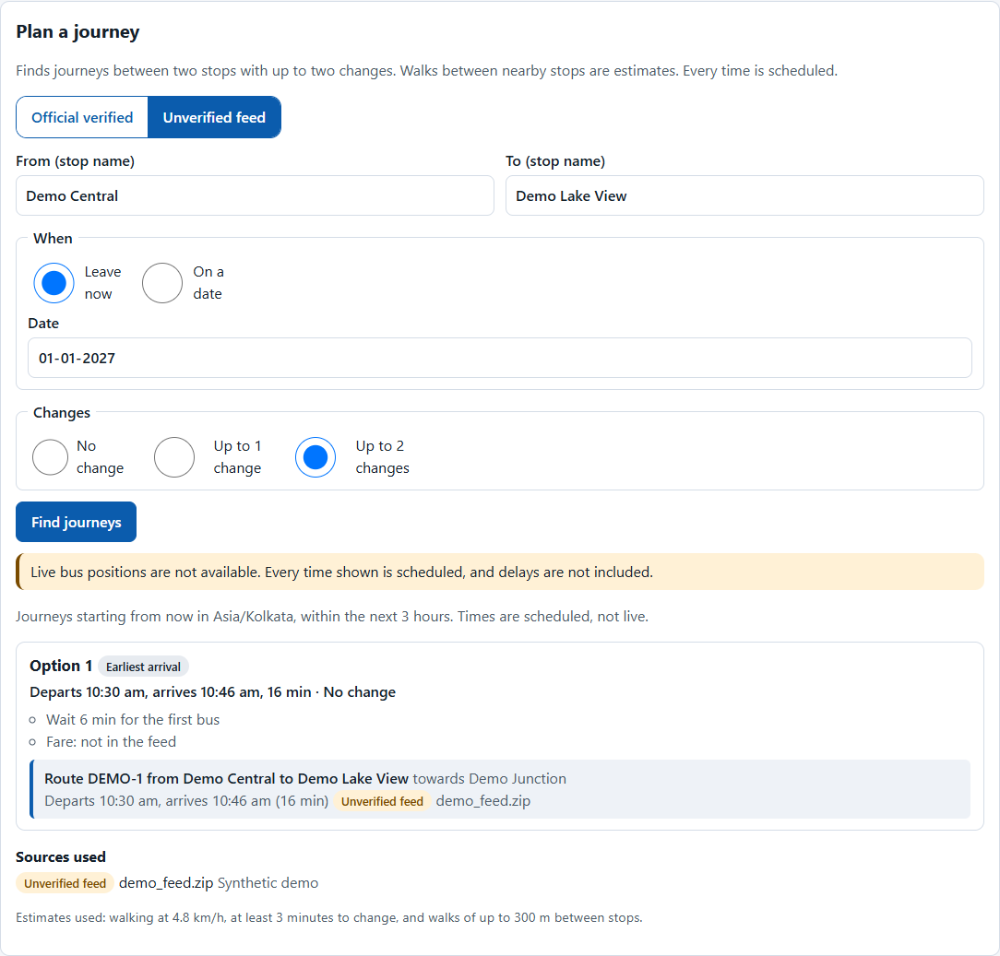
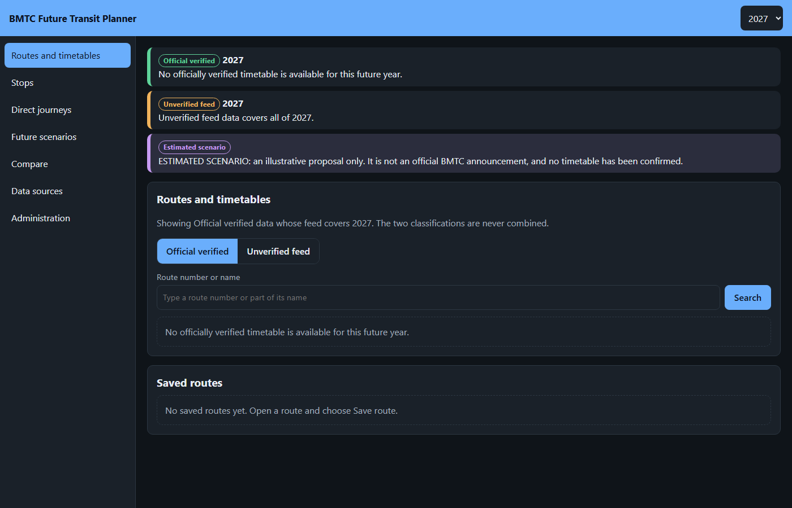
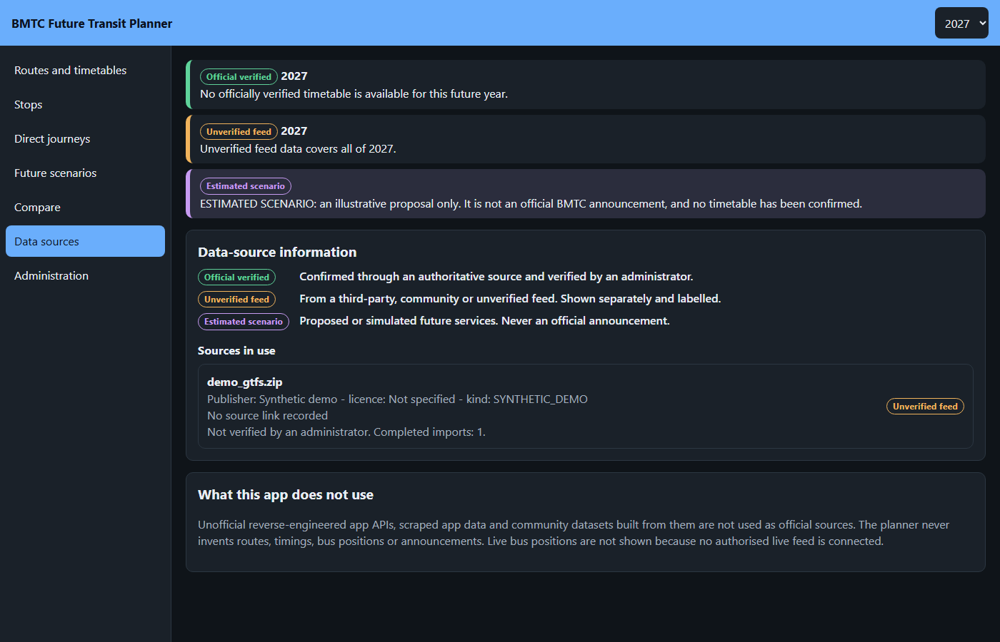
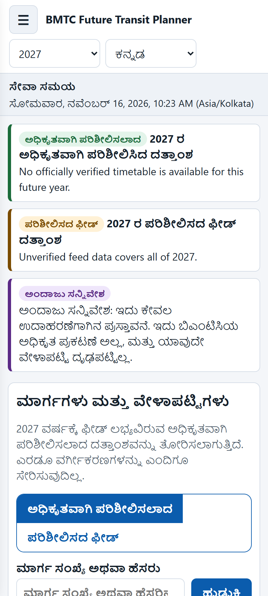
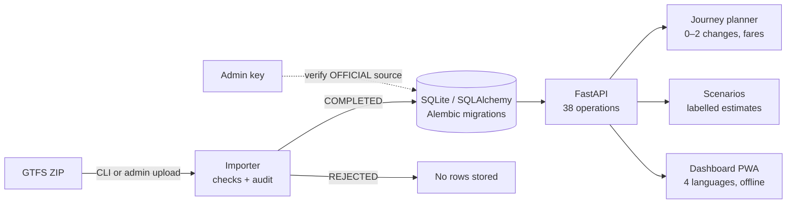

<div align="center">


<br>

# 🚌 BMTC Future Transit Planner 3.0

**Plan Bengaluru bus journeys today and sketch the network of 2027 to 2030, without ever mixing guesses with facts.**

[](https://github.com/upendra8690/BMTC-Future-Transit-Planner-3.0/actions/workflows/ci.yml)
[](https://github.com/upendra8690/BMTC-Future-Transit-Planner-3.0/actions/workflows/android-apk.yml)
[](https://bmtc-future-transit-planner-3-0.onrender.com/)


<a href="https://bmtc-future-transit-planner-3-0.onrender.com/"></a>
&nbsp;
<a href="https://github.com/upendra8690/BMTC-Future-Transit-Planner-3.0/releases/latest/download/BMTC-Planner.apk"></a>

<sub>Free hosting: the server sleeps when idle, so the first visit can take up to a minute to wake it.</sub>

[**Why**](#-why-this-exists) · [**Screenshots**](#-screenshots) · [**What's new**](#-whats-new-in-30) · [**Quick start**](#-quick-start) · [**Features**](#-features) · [**API**](#-api-in-30-seconds) · [**Architecture**](#%EF%B8%8F-architecture) · [**Quality**](#-quality) · [**Roadmap**](#%EF%B8%8F-roadmap)

<sub>⚠️ Unofficial. Not affiliated with, endorsed by or authorised by BMTC, BMRCL, Namma Metro or any transport operator. Ships no official BMTC timetable data.</sub>

</div>

---

## 💡 Why this exists

Bengaluru is growing fast, and people want to know what the buses will look like in **2027, 2028, 2029 and 2030**. Nobody has official timetables for those years yet. A planning tool that blurs guesses with facts is worse than no tool at all.

This planner keeps **three kinds of information strictly apart**, and labels every screen, every journey and every export:

| | Classification | What it means |
|:---:|---|---|
| 🟢 | **`OFFICIAL_VERIFIED`** | Timetables from an `OFFICIAL` source that an administrator has checked and verified. Empty until that happens. |
| 🟡 | **`UNVERIFIED_FEED`** | Any other GTFS feed: community, third-party or demo. Shown separately, always labelled with its source. |
| 🟣 | **`ESTIMATED_SCENARIO`** | Your own "what if" route for a future year, with journey time worked out from labelled assumptions. **Never** an official announcement. |

When there is no verified timetable for a year, the planner says so plainly instead of inventing one:

> 🗨️ *"No officially verified timetable is available for this future year."*

<div align="center">

| **366** | **121** | **20 / 20** | **38** | **4** | **2027 – 2030** |
|:---:|:---:|:---:|:---:|:---:|:---:|
| automated tests | browser checks | broken rules caught by mutation checks | API operations | UI languages | planning years |

</div>

## 📸 Screenshots

<table>
<tr>
<td width="50%"></td>
<td width="50%"></td>
</tr>
<tr>
<td align="center"><b>🧭 Journey planner</b><br><sub>Up to two changes, ranked by arrival. Every ride names its feed and every assumption is stated.</sub></td>
<td align="center"><b>🗓️ Routes and timetables</b><br><sub>Each page opens with the status of the chosen year for each classification.</sub></td>
</tr>
<tr>
<td width="50%"></td>
<td width="50%" align="center"></td>
</tr>
<tr>
<td align="center"><b>🗂️ Data sources</b><br><sub>Where every timetable came from, and how it is classified.</sub></td>
<td align="center"><b>📱 Phone layout, in Kannada</b><br><sub>English, ಕನ್ನಡ, తెలుగు and हिन्दी.</sub></td>
</tr>
</table>

<sub>Screenshots show the invented <code>SYNTHETIC_DEMO</code> feed (routes DEMO-1 and DEMO-2). They are not BMTC routes.</sub>

## ✨ What's new in 3.0

| | Feature | Details |
|:---:|---|---|
| 🔀 | **Journeys with up to two changes** | `GET /api/plan` returns options ranked by arrival, then by changes, and labels `EARLIEST_ARRIVAL` and `FEWEST_CHANGES`. |
| 💸 | **Fares from GTFS** | `fare_attributes.txt` and `fare_rules.txt` are imported (migration `0002_fares`). A fare is shown only when exactly one applies. |
| 📴 | **Offline timetables** | The service worker keeps up to 120 saved API answers, shows an offline banner and retries after reconnecting. |
| 🌐 | **Telugu** | A fourth language, 344 keys in each. |
| 🕒 | **Service clock** | `/api/clock` reports the feed's own time zone, with `Asia/Kolkata` as the fallback. |
| 🛡️ | **Security mapping** | `docs/SECURITY_ASVS.md` maps the planner to OWASP ASVS 5.0.0 and the Top 10:2025, gaps included. |
| ♿ | **Accessibility engine** | Browser checks run axe-core 4.14.0 against WCAG 2.1 AA. |

Full list in [`CHANGELOG.md`](CHANGELOG.md).

## 🚀 Quick start

### 📱 On your phone (no Play Store needed)

- **Android app:** download [`BMTC-Planner.apk`](https://github.com/upendra8690/BMTC-Future-Transit-Planner-3.0/releases/latest/download/BMTC-Planner.apk) from the [latest release](https://github.com/upendra8690/BMTC-Future-Transit-Planner-3.0/releases/latest) and open it. Android asks once to allow installs from your browser; that is normal for apps outside the Play Store.
- **Any phone (Android or iPhone):** open [bmtc-future-transit-planner-3-0.onrender.com](https://bmtc-future-transit-planner-3-0.onrender.com/) and choose **Install app** (Chrome) or **Share → Add to Home Screen** (Safari). It works offline after the first visit.

The live demo loads the invented `SYNTHETIC_DEMO` feed on every start (`scripts/seed_demo_feed.py`), and anything created there is wiped when the free server restarts.

### 🪟 Windows (two clicks)

```bat
scripts\setup_windows.bat    :: once: creates .venv, installs packages, prepares the database
scripts\run_windows.bat      :: then open http://127.0.0.1:8000/
```

Set `ADMIN_API_KEY` in `.env` to enable the Administration page. Full guide in [`docs/INSTALL_WINDOWS.md`](docs/INSTALL_WINDOWS.md).

### 🐧 Linux / macOS / any Python 3.11+

```bash
git clone https://github.com/upendra8690/BMTC-Future-Transit-Planner-3.0.git
cd BMTC-Future-Transit-Planner-3.0

python -m venv .venv && . .venv/bin/activate
python -m pip install -r requirements-dev.txt
cp .env.example .env
python scripts/migrate_database.py

# Load the invented demo feed so there is something to explore
python scripts/make_synthetic_gtfs.py --out data/demo_feed.zip
python scripts/import_gtfs.py --file data/demo_feed.zip --new-source "Synthetic demo" --kind SYNTHETIC_DEMO

python -m uvicorn app.main:create_app --factory --app-dir backend --host 127.0.0.1 --port 8000
```

Open **http://127.0.0.1:8000/**, switch to **Unverified feed**, and plan a trip from *Demo Central* to *Demo Lake View*. Interactive API docs are at **/api/docs**.

### 🐳 Docker + Caddy (HTTPS)

```bash
cp .env.example .env     # set ADMIN_API_KEY and PLANNER_DOMAIN
docker compose up -d --build
```

See [`docs/DEPLOY.md`](docs/DEPLOY.md). The Compose file is validated, but the image has not yet been built or run.

## 🧩 Features

<table>
<tr>
<td width="50%" valign="top">

**🗺️ Planning**
- Timetables by route and date, route and stop search
- Departures from a stop, nearby stops on a Leaflet map
- Journeys with 0, 1 or 2 changes, walks marked as estimates
- Fares straight from the feed
- Saved routes per device

</td>
<td width="50%" valign="top">

**🔮 Future scenarios**
- Owner-scoped "what if" routes for 2027 to 2030
- Distance, journey time and frequency from labelled assumptions
- Side-by-side comparison
- CSV and PDF export

</td>
</tr>
<tr>
<td valign="top">

**🛠️ Administration**
- GTFS import from the CLI or the dashboard, checked before storing
- Verification and revocation of `OFFICIAL` sources
- Audit log of every admin action
- Verified SQLite backups, database check, restore drill

</td>
<td valign="top">

**📱 Everywhere**
- Installable PWA with offline shell and saved timetables
- English, Kannada, Telugu, Hindi
- Times in the service time zone
- 38 documented API operations with OpenAPI

</td>
</tr>
</table>

## ⚡ API in 30 seconds

```bash
curl "http://127.0.0.1:8000/api/plan?origin=Demo%20Central&destination=Demo%20Lake%20View&classification=UNVERIFIED_FEED"
```

```jsonc
{
  "classification": "UNVERIFIED_FEED",
  "max_changes": 2,
  "options": [{
    "changes": 0,
    "departs_at": "2026-11-16T10:30+05:30",
    "arrives_at": "2026-11-16T10:46+05:30",
    "duration_minutes": 16,
    "fare": { "code": "NOT_IN_FEED", "total": null },
    "labels": ["EARLIEST_ARRIVAL"],
    "legs": [{ "type": "ride", "timing": "scheduled", "route_number": "DEMO-1", "...": "..." }]
  }]
}
```

| Endpoint | What it does |
|---|---|
| `GET /api/meta` | Version, classifications, affiliation notice, estimate assumptions |
| `GET /api/clock` | Service time zone, local time and feed coverage for today |
| `GET /api/routes` · `GET /api/stops` | Search routes and stops for one classification |
| `GET /api/plan` | Journeys with up to two changes |
| `GET /api/docs` | Interactive OpenAPI docs |

All 38 operations are documented in [`docs/API.md`](docs/API.md).

## 🏗️ Architecture



| Layer | Stack |
|---|---|
| Backend | Python, FastAPI, SQLAlchemy, Alembic, uvicorn |
| Data | GTFS static feeds, SQLite (PostgreSQL possible but untested) |
| Frontend | Plain HTML, CSS and JavaScript, Leaflet 1.9.4, service worker |
| Deploy | Docker, Caddy (automatic HTTPS) |
| Mobile | Flutter WebView starter in `android/` (not yet built) |

More in [`docs/architecture.md`](docs/architecture.md).

## ✅ Quality

| Check | Result |
|---|---|
| 🧪 Automated tests | **366 passed** on Linux, Python 3.13. On Windows with Python 3.12: 361 passed, 5 skipped (the DejaVu Sans font is not installed) |
| 🌐 Browser checks | **121 passed** in headless Chrome, including axe-core WCAG 2.1 AA |
| 🧬 Mutation checks | **10 / 10** broken rules caught in each of two harnesses |
| 💾 Restore drill | **29 / 29** checks passed |
| 🧹 Lint | `ruff check .` clean |
| 🔒 Static security | bandit: no issues in the documented scope |
| 📦 Dependency audit | No known vulnerabilities in the pinned versions |

Every command and number is in [`docs/TEST_RESULTS.md`](docs/TEST_RESULTS.md). CI runs lint, migrations and tests on Python 3.12 and 3.13 for every push.

## 🛡️ Security in brief

- 🔑 Admin functions need `ADMIN_API_KEY`. They return 503 while it is empty and 401 for a wrong key. The key is compared in constant time and never stored in the browser.
- 🧾 Devices are identified by a random `X-Client-Key`, and only its SHA-256 hash is stored.
- 🚦 Each client IP is limited to 120 requests a minute by default, with `429` and `Retry-After`.
- 🧱 A strict Content Security Policy allows scripts only from the planner's own origin.
- 🌍 Plain HTTP is the default. Use HTTPS (the Docker + Caddy kit) for anything beyond a trusted network.

## 🗺️ Roadmap

- [x] Journeys with up to two changes
- [x] GTFS fares
- [x] Offline timetables and installable PWA
- [x] Telugu translation
- [ ] Verified official BMTC GTFS feed (needs a reachable source with a clear licence, see [`SOURCES.md`](SOURCES.md))
- [ ] Namma Metro integration
- [ ] Live bus positions from a verified GTFS-Realtime feed
- [ ] Native-speaker review of Kannada, Telugu and Hindi
- [ ] Android APK build and on-device PWA install test
- [ ] Production deployment testing

<details>
<summary><b>⚠️ Known limits of this build (click to expand)</b></summary>

<br>

- No official BMTC timetable is loaded, and none is shown for 2027 to 2030.
- No Namma Metro data. Journeys ignore route type.
- No live bus positions or delays.
- Only the synthetic demo feed has been tested. No real city feed has been tested.
- Kannada, Telugu and Hindi text is a first draft. Right-to-left languages have not been tested.
- The Docker image has not been built, and the Android starter has not been compiled.
- Nothing has been run on a real phone. Phone layout was checked in headless Chrome only.
- Fares that depend on origin, destination or zone, and transfer fare rules, are not applied.
- Scenario estimates use placeholder assumptions (15 km/h average speed, 0.5 min dwell per stop, detour factor 1.3) that need calibrating against real data.
- Not production ready.

</details>

## 📚 Documentation

| Document | For |
|---|---|
| [`docs/INSTALL_WINDOWS.md`](docs/INSTALL_WINDOWS.md) | Installing, running, loading data, backups and restore on Windows |
| [`docs/PHONE_ACCESS.md`](docs/PHONE_ACCESS.md) | Using the planner from phones |
| [`docs/DEPLOY.md`](docs/DEPLOY.md) | Linux server with Docker and Caddy |
| [`docs/API.md`](docs/API.md) | The full API |
| [`docs/architecture.md`](docs/architecture.md) | Components, data flow and the security model |
| [`docs/SECURITY_ASVS.md`](docs/SECURITY_ASVS.md) | OWASP ASVS 5.0.0 and Top 10:2025 mapping |
| [`docs/TRANSLATION.md`](docs/TRANSLATION.md) | Adding or reviewing a language |
| [`docs/PRIVACY.md`](docs/PRIVACY.md) | What data is kept, where and for how long |
| [`docs/TEST_RESULTS.md`](docs/TEST_RESULTS.md) | Every verification run, with real results |
| [`database/README.md`](database/README.md) | Tables, migrations, backups |
| [`SOURCES.md`](SOURCES.md) | Data sources and what official data would need |

<details>
<summary><b>📁 Repository layout</b></summary>

```
backend/app/        API, journey planner, services, GTFS importer, security, database, service clock
dashboard/          web dashboard, translations, service worker, manifest, vendored Leaflet
scripts/            CLI tools, benchmark, restore drill, Windows launchers (.bat)
migrations/         Alembic: 0001 baseline, 0002 fares
tests/              pytest suite, browser checks (with vendored axe-core), mutation checks
docs/               guides, architecture, security mapping, test results
deploy/             Caddy configuration
android/            Flutter WebView starter (not built)
assets/             banner and screenshots
```

</details>

## 🤝 Contributing

Issues and pull requests are welcome. Please:

1. Keep the three classifications apart. Never present unverified or estimated data as official.
2. Run `python -m ruff check .` and `python -m pytest` before opening a PR.
3. Native speakers of Kannada, Telugu or Hindi: reviews of `dashboard/i18n.js` are especially valuable. See [`docs/TRANSLATION.md`](docs/TRANSLATION.md).

## 📄 Licence

No licence has been chosen for this project yet, so default copyright applies. Vendored Leaflet 1.9.4 is BSD 2-Clause (`dashboard/vendor/leaflet/`). axe-core 4.14.0, used only by the browser checks, is MPL 2.0 (`tests/browser/vendor/axe-core/`).

<div align="center">

<br>

**If this project is useful to you, please ⭐ star the repo!**

<sub>Made for Bengaluru commuters, planners and transit enthusiasts. Unofficial, and proud of saying so.</sub>

</div>
