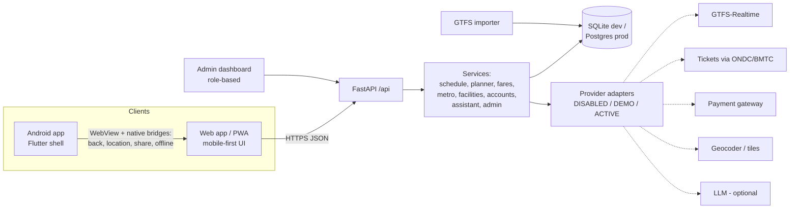

# Architecture for 4.0

## 1. Target shape

Dotted lines are integrations that stay `DISABLED` until an operator authorises them.

## 2. Decisions

**Decided by the owner on 16 November 2026:**

| Decision | Choice |
|---|---|
| D1 UI | One responsive web UI (the PWA, redesigned mobile-first) inside the Flutter Android shell with native bridges |
| D3 Database | Free Neon Postgres for production accounts (owner sets it up at Phase 5); SQLite for development and tests |
| D4 Data | Official DULT Transport Data Hub feed first (owner downloads it with its licence page); demo data until then; a community Metro feed only as `UNVERIFIED_FEED` and only if its licence allows |
| D-NAME | The app is renamed **Bengaluru Transit Planner**. "BMTC" and "Namma Metro" appear only in descriptions, with the unofficial notice. The GitHub repository name stays. |

The options considered are kept below for the record.

### D1. One UI or two? (needs your answer)
- **Recommended: one responsive web UI** (the existing PWA, redesigned mobile-first), shown inside the Flutter app with
  native bridges for back navigation, location permission, sharing and an offline screen. One codebase, one set of
  translations and tests, fits ₹0 and one developer.
- Alternative: a fully native Flutter UI plus the web UI. More native feel, but every screen is built and tested twice.

### D2. Routing engine
- **Keep and extend the existing RAPTOR planner.** It already plans across several feeds with walking transfers.
  Add mode filters (bus/metro), `transfers.txt` support, access/egress walks from a map point, and per-leg fares.
- Not OpenTripPlanner: it needs a JVM and several GB of RAM, beyond free hosting.

### D3. Database for accounts (needs your answer)
- SQLite stays for development and tests.
- **Recommended for production: free hosted Postgres (Neon)**, because Render's free disk is wiped on restart.
  SQLAlchemy already supports Postgres; CI will run the test suite against Postgres too.
- Without it, accounts would reset on every restart, so Phase 5 stays device-only.

### D4. Data for real coverage (needs your answer)
- **Recommended:** try the official DULT Transport Data Hub feed first (your browser, your registration); import it
  as `OFFICIAL` and verify it only with its licence page as evidence.
- A community Metro feed (`Vonter/bmrcl-gtfs`) can be loaded as `UNVERIFIED_FEED` once its licence is checked.
- Community BMTC feeds derived from the Namma BMTC app are **not** used.

### D-NAME. App name (needs your answer)
"BMTC" in the name plus a Namma BMTC-style home screen risks looking official, and stores remove apps that imply an
affiliation. Options: keep "BMTC Future Transit Planner" with "Unofficial" visible everywhere; or rename the app
(for example "Bengaluru Transit Planner") while keeping BMTC in descriptions only.

### D5. Provider adapters
Each external service is a Python class implementing a small interface (`status()`, `fetch()` or `create()`), selected
by configuration. `/api/features` reports each feature's state and reason, and the UI renders from it, so a disabled
feature explains itself instead of failing.

### D6. Live tracking
A GTFS-Realtime adapter parses vehicle positions and trip updates into a short-lived `vehicle_positions` table with
freshness rules: positions older than 2 minutes are "stale", older than 10 minutes are hidden. Without a feed, the
map shows only scheduled times, labelled as scheduled.

### D7. Authentication
Email + password (argon2id), server-side sessions in httpOnly `SameSite=Lax` cookies, CSRF token for state-changing
requests, rate-limited login. Guest mode keeps the device key; on sign-up, device data can be moved to the account.
No SMS OTP (paid).

### D8. AI assistant
A retrieval layer exposes safe tools (search stops, plan journey, get fares, nearby facilities) over the existing
services. The free default parses common questions with rules; an optional LLM uses the same tools. Every answer
carries source and last-updated time, and says so when data is missing.

### D9. Admin
Admin accounts with roles (`viewer`, `editor`, `admin`). The existing `ADMIN_API_KEY` remains only to create the first
admin. Every admin action keeps going to the audit log.

### D10. Maps
Leaflet stays. Tile URL and attribution are configuration. Geocoding goes through the server with caching and the
provider's rate limit.
