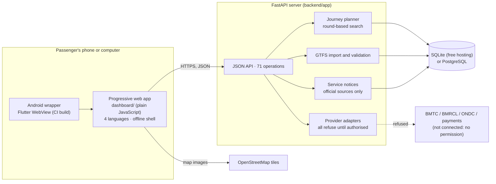

# System architecture: Bengaluru Transit Planner 4.0

As of 19 November 2026, branch `v4`. A fuller description for reviewers is in
`government_submission_2026/05_SYSTEM_ARCHITECTURE.md`.

## Components
| Part | Technology | Notes |
|---|---|---|
| Server | Python 3.12 and 3.13, FastAPI, SQLAlchemy 2, Alembic, uvicorn | One process; security headers, CSP, per-visitor rate limit |
| Database | SQLite in development and on free hosting; PostgreSQL through `DATABASE_URL` (psycopg 3) | 25 tables, 5 migrations, applied on every start |
| Web app | Plain JavaScript PWA, Leaflet 1.9.4, service worker | No build step; about 100 KB compressed plus the map library |
| Android | Flutter WebView wrapper | Native project generated by CI; APK and AAB built as checks |
| Hosting | Render, Docker, Singapore | 4.0 from `v4`; 3.0 from `main`; separate services |
| CI | GitHub Actions | Tests (3.12, 3.13) with ruff, bandit, pip-audit; container in demo and real mode; PostgreSQL persistence; Android build |

## API (71 operations)
| Area | Operations | Examples |
|---|---|---|
| system | 12 | `/api/health`, `/api/meta`, `/api/features`, `/api/notices`, `/api/upcoming`, `/api/data-status` |
| timetables | 11 | `/api/routes`, `/api/stops`, `/api/stops/nearby`, `/api/plan`, `/api/metro/stations` |
| admin | 16 | data sources, imports, verification, backups, audit log, upcoming transport, service notices, users |
| account | 14 | register, sign in, recover, export, delete, saved journeys, notifications (all off until PostgreSQL) |
| scenarios | 9 | estimated future routes for 2027 to 2030, with CSV and PDF |
| user | 6 | device-scoped saved routes, preferences, "delete my data" |
| years, sources | 3 | planning-year status, data sources |

Interactive documentation: `/api/docs`.

## Data model (25 tables)
- **Timetables (GTFS):** `data_sources`, `verification_records`, `gtfs_imports`, `agencies`, `routes`, `stops`,
  `service_calendars`, `service_exceptions`, `trips`, `stop_times`, `shape_points`, `fare_attributes`, `fare_rules`.
- **Information:** `transport_announcements`, `transport_announcement_changes`, `service_notices` (new, migration 0005).
- **Device data:** `saved_routes`, `user_preferences`, `scenarios`, `scenario_stops`.
- **Accounts (off):** `users`, `user_sessions`, `user_saved_journeys`, `notification_preferences`.
- **Audit:** `audit_logs`.

## Data rules built into the code
- Every timetable belongs to a source of kind `OFFICIAL`, `COMMUNITY`, `SYNTHETIC_DEMO` or `UNKNOWN`.
- Only an `OFFICIAL` source can be marked "Officially verified", after an administrator records evidence.
- `SYNTHETIC_DEMO` data is served only when `DEMO_MODE=1`.
- Community timetables are labelled "Unverified feed" with approximate times; their fares are never shown.
- Service notices must link to a government site, `bmrc.co.in`, or the official BMTC or BMRCL account on X, and end
  within 31 days.

## Deployment
| Item | Where |
|---|---|
| Blueprint | `render.yaml` (4.0 service only) |
| Start script | `scripts/container_start.sh` (sets the visitor-address header and temporary-storage flag on Render) |
| Health check | `/api/health` |
| Migrations | Run automatically at start (`backend/app/schema_migrations.py`) |
| Checker | `scripts/verify_deployment.py <url> --v3 <3.0 url>` |
| Guides | `docs/launch/DEPLOYMENT_GUIDE.md`, `docs/launch/POSTGRESQL_PRODUCTION.md` |
