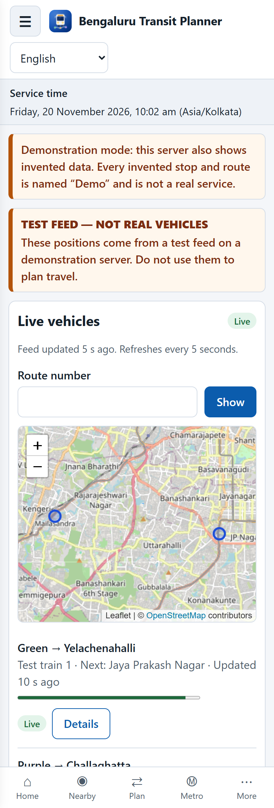
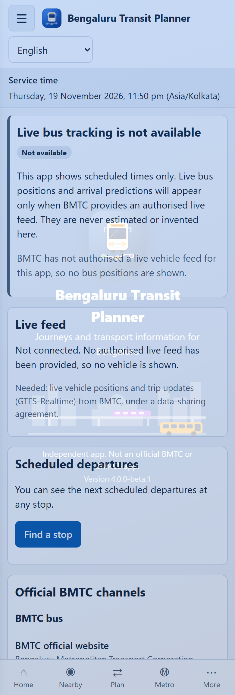

# Live bus tracking: the GTFS-Realtime provider adapter

**Status on 20 Nov 2026: IMPLEMENTED BUT NOT FULLY VERIFIED. WAITING FOR OFFICIAL API/PERMISSION.**
The live-tracking subsystem is built and tested end to end, but only with test feeds. No BMTC live feed is
connected, so the public service shows "Not connected" and no vehicle. Every statement below about live data
describes what happens once an authorised feed is configured.

## What is needed from BMTC
- **GTFS-Realtime VehiclePositions** (one entity per vehicle) and **GTFS-Realtime TripUpdates** (arrival or departure
  estimates per stop), over HTTPS, refreshed at least every 30 seconds.
- **The matching static GTFS timetable.** Trip, route and stop ids in the live feed must match it, and it must be
  imported as `OFFICIAL_VERIFIED`.
- **An access key**, if BMTC requires one, sent as one HTTP header.
- **A data-sharing agreement** that allows the positions to be shown to the public.

## Connecting the feed (no code change)
Set these in the hosting dashboard, never in GitHub:

| Variable | Value |
|---|---|
| `REALTIME_VEHICLES_URL` | The VehiclePositions URL (https only) |
| `REALTIME_TRIP_UPDATES_URL` | The TripUpdates URL (https only) |
| `REALTIME_AUTH_HEADER` | `Header-Name: value`, if a key is required. Never logged, stored or returned |
| `REALTIME_SOURCE_KIND` | `OFFICIAL` |
| `REALTIME_CLASSIFICATION` | `OFFICIAL_VERIFIED` (the static timetable the feed belongs to) |
| `REALTIME_POLL_SECONDS` | How often the feed is read, 5–600 (default 20) |
| `REALTIME_STALE_SECONDS` | After this many seconds a position is labelled "Delayed" (default 120) |

A feed in another format (for example JSON) needs one new provider class with a `fetch() -> Feed` method in
`backend/app/services/realtime.py`. Nothing else changes.

## What the app does with it
| Capability | Where | Rule |
|---|---|---|
| Live map and vehicle list | Live screen | Each vehicle with its route number, direction (headsign), next stop, progress bar and "Updated N s ago" |
| Vehicle identification | List, map, details | The vehicle label from the feed (for example a fleet number) |
| Current location | Map | The position from the feed. Positions older than 10 minutes are not shown at all |
| Next stop and route progress | List and details | From the vehicle's stop sequence and status, matched with the trip's stops in the timetable |
| Last updated, data freshness | Every vehicle and the feed | "Live" up to `REALTIME_STALE_SECONDS`, then "Delayed"; the feed age is shown |
| Arrival estimates | Vehicle details: "Stops ahead" | From TripUpdates. A delay given at one stop applies to the later stops (GTFS-Realtime rule). Stops with no estimate keep the scheduled time, labelled "Scheduled". Skipped stops are labelled "Skipped" |
| Stop-wise arrivals | Each stop page: "Live arrivals" | Only live estimates, labelled "Live estimate", within the next two hours. Cancelled trips are left out. The scheduled table on the same page keeps its "scheduled" label |
| Route filter | Live screen | By route number or GTFS route id |
| Feed problems | Live screen | "Not connected", "Not used" (unsafe settings), "Could not be read" or "Not updated recently". No old or guessed position replaces a missing one |

## Safeguards
- **No feed configured:** `GET /api/live/status` reports `NOT_CONNECTED` with what is needed, the feature list shows
  live tracking as unavailable, and `/api/meta` reports `live_positions_available: false`.
- **Official feeds use https.** A `TEST` feed may use `http://127.0.0.1`, but only on a demonstration server
  (`DEMO_MODE=1`). There, every live screen shows "TEST FEED — NOT REAL VEHICLES", and live tracking never counts as
  available.
- **Limits:** responses over 8 MB are refused, requests time out after 10 seconds, and the feed is read at most once
  per poll interval however many people are looking.
- **Decoding:** a small decoder for exactly the GTFS-Realtime fields used. Anything that is not a feed message is
  refused (`FEED_INVALID`).

## API
- `GET /api/live/status`
- `GET /api/live/vehicles?route=`
- `GET /api/live/vehicles/{vehicle_id}`
- `GET /api/live/stops/{stop_id}/arrivals`

## Tests
- `tests/test_realtime.py`: 26 tests. They cover decoding, refusal of non-feeds, the not-connected state, test feeds
  refused in real mode, unsafe settings, matching, freshness, hiding old positions, the route filter, stopped
  vehicles, delay propagation, scheduled labels, skipped stops, stop arrivals, cancelled trips, read errors, stale
  feeds, poll limits, the secret header and oversized feeds.
- `tests/browser/live_check.py`: 15 browser checks. A local test feed is built from the pinned community Metro
  timetable for the server's clock. The checks then confirm the TEST label, list, map, filter, details, stop arrivals,
  and "Not connected" on a real-mode server.

Not verified: a real BMTC feed, its ids, its update rate and its accuracy. These can only be tested after access is
granted.
