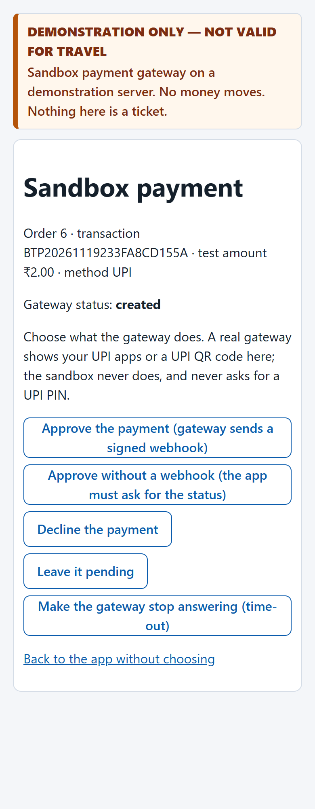
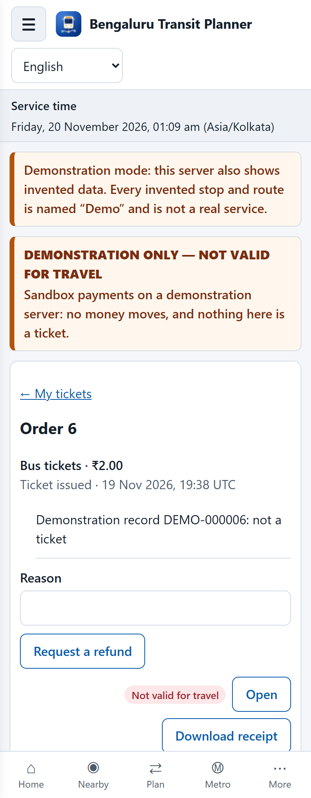

# Payments (UPI) and ticketing: architecture, sandbox and what is still needed

**Status on 20 Nov 2026:**
- **Payment architecture:** IMPLEMENTED AND TESTED in the sandbox.
- **Razorpay adapter:** IMPLEMENTED BUT NOT FULLY VERIFIED. It is tested against recorded responses only, and needs
  merchant onboarding.
- **BMTC ticketing:** WAITING FOR OFFICIAL API/PERMISSION.
- **Public service:** nothing can be bought, and every purchase answers "not available" with what is needed.

## How a payment works
1. **Order on the server.** The passenger chooses a product, and the ticketing provider quotes the fare. The server
   creates the order with an idempotency key, so a double tap makes one order.
2. **Payment on the provider's side.** The server creates a payment with the gateway and gives it a unique
   transaction id of its own (`BTP` + date + 12 random hex characters). The passenger goes to the gateway's page:
   - on a phone, the page offers the installed UPI apps (UPI Intent);
   - on a desktop, it shows a UPI QR code.

   Alternatively, a single-use UPI QR code for the exact amount can be created ("UPI QR code"). Only one payment
   attempt can be in progress per order.
3. **Confirmation, server to server only.** The order becomes paid only when one of these says so for the exact
   amount:
   - the gateway's **signed webhook** (HMAC-SHA256, checked in constant time, each event processed once); or
   - the gateway's **status API**, which this server asks when the passenger comes back ("Check payment status"),
     after a restart, or from an administrator (`POST /api/admin/payments/reconcile`).

   Returning from the UPI app proves nothing, and the browser is never asked whether payment succeeded.
4. **Ticket.** After payment, the ticketing provider issues the ticket. If it cannot, the money is refunded
   automatically.
5. **Pending and expiry.** A payment still pending after 30 minutes expires. If the gateway later takes the money
   anyway, it is refunded automatically, never kept without a ticket.
6. **Refunds.** An unused ticket can be refunded once the operator cancels it. A refund is complete only when the
   gateway's signed webhook says so; a failed refund is recorded.
7. **Records.** Orders, payments (provider reference and transaction id only), tickets as issued, refunds and
   processed notifications are kept (migrations 0006 and 0007). They stay when an account is deleted. Each step is in
   the audit log: `order.create`, `payment.start`, `payment.succeeded`, `payment.failed`, `payment.expired`,
   `payment.amount_mismatch`, `ticket.issued`, `refund.requested`, `refund.completed`, `refund.failed` and
   `payments.reconcile`.
8. **Never accepted:** card numbers, CVVs, UPI PINs, OTPs or passwords. Requests that contain them are refused. A
   stored-value wallet is not offered either, because it needs an RBI prepaid payment instrument licence.

States:
- **Order:** CREATED, PAYMENT_PENDING, PAID, ISSUED, FAILED, REFUND_REQUESTED, REFUNDED.
- **Payment:** PENDING, SUCCEEDED, FAILED, EXPIRED, AMOUNT_MISMATCH.
- **Refund:** PROCESSING, COMPLETED, FAILED.

## Merchant onboarding (owner steps; nothing to change in code)
1. Choose an RBI-authorised payment aggregator and complete its merchant onboarding (KYC, business details,
   settlement account). The adapter written here is for **Razorpay**; another aggregator needs one new adapter class
   with the same five methods.
2. In the aggregator's dashboard:
   - enable UPI and payment links (and UPI QR codes, if wanted);
   - add a webhook to `https://<your server>/api/commerce/notifications/razorpay` for the events `payment_link.paid`,
     `payment_link.expired`, `payment_link.cancelled`, `qr_code.credited`, `qr_code.closed`, `refund.processed` and
     `refund.failed`, with a long random secret.
3. Test first, on a separate demonstration server (`DEMO_MODE=1`), with **test** keys:
   `PAYMENT_PROVIDER=razorpay`, `PAYMENT_ENVIRONMENT=sandbox`, `RAZORPAY_KEY_ID=rzp_test_...`,
   `RAZORPAY_KEY_SECRET`, `RAZORPAY_WEBHOOK_SECRET`, `PUBLIC_BASE_URL=https://...`, `TICKETING_PROVIDER=sandbox`.
4. Production needs **live** keys (`rzp_live_...`), `PAYMENT_ENVIRONMENT=production` and a production ticketing
   provider. No such provider exists until BMTC (or ONDC with BMRCL) grants access, so nothing is sold before then.

Secrets go only into the hosting dashboard, never into GitHub or the app's JavaScript. Unsafe combinations are refused
when the server starts, and the reason is listed in `GET /api/commerce/status` under `refused_settings`. The refused
combinations are:
- test keys in production;
- live keys in the sandbox;
- a sandbox anywhere except a demonstration server;
- a public address without https;
- missing secrets;
- sandbox and production providers mixed.

## The sandbox environment (non-public)
- **Where:** only on a demonstration server: `DEMO_MODE=1`, `PAYMENT_ENVIRONMENT=sandbox`, `PAYMENT_PROVIDER=sandbox`,
  `TICKETING_PROVIDER=sandbox`, and a `PAYMENT_SANDBOX_STATE` file. The public service runs with `DEMO_MODE=0` and can
  never use it.
- **Labels:** every screen and receipt says **DEMONSTRATION ONLY — NOT VALID FOR TRAVEL**.
- **Amounts and records:** amounts are ₹1 per passenger, labelled "Sandbox test amount: not a fare". Records are
  "Demonstration record DEMO-...: not a ticket", with no QR code and no validity.
- **The simulated gateway:** `/sandbox/pay/{ref}` stands in for the gateway's page. The tester chooses the outcome:
  - approve (signed webhook);
  - approve without a webhook (the app's status check must find it);
  - decline;
  - leave pending;
  - stop answering (time-out).

  `/sandbox` completes or fails refunds. Its signing secret is random, made on first use, and never written in code.

## BMTC ticketing adapter
`BmtcTicketingAdapter` (in `backend/app/services/payment_providers.py`) is the place for BMTC's authorised ticketing
provider. It refuses every call with `AWAITING_BMTC_API_SPECIFICATION`, and setting `TICKETING_PROVIDER=bmtc` is
refused at start-up. Nothing is guessed about an API that has not been shared. To connect it, BMTC needs to provide:
- the endpoints;
- authentication;
- fare quotes and issuing;
- the ticket and pass formats, including the QR content and how conductors validate it;
- cancellation and refund rules;
- sandbox access.

Metro QR tickets need ONDC registration and BMRCL approval in the same way.

## Tests (20 Nov 2026)
| Suite | Result |
|---|---|
| `tests/test_payment_sandbox.py` | 17 passed. Covers: success, failure, pending with expiry and a late success refunded, a duplicate callback, an invalid signature, a time-out then a later check, one attempt at a time, a refund, a failed refund, a restart of this server mid-payment (reconciled afterwards), environment separation and no QR codes |
| `tests/test_razorpay_adapter.py` | 21 passed. Covers: refused merchant settings; the payment-link and UPI QR requests; provider errors without secrets; signed webhooks (paid, QR credited, refund, ignored); wrong signatures; status checks; time-outs; refunds; the BMTC adapter refusing |
| `tests/test_commerce.py` | 24 passed. Covers the workflow rules with test doubles |
| `tests/browser/payments_sandbox_check.py` | 15/15 in Edge on a local demonstration server. Covers the full flow, including a time-out and a refund at the gateway, and confirms there is no buy form and no sandbox page on a real-mode server |

**Not verified:**
- Razorpay itself. This needs the owner's test keys.
- A real UPI app on a phone.
- BMTC or BMRCL ticketing, for which no access exists.
